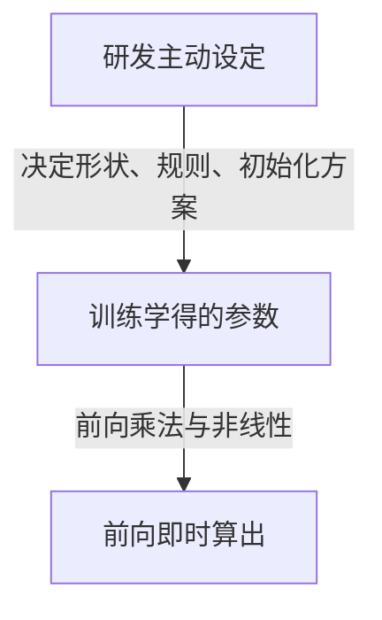

我们现在使用的基本都是**补全模型**（decoder-only），尤其是代码智能体。

**上下文长度**（上下文窗口）是模型一次可以处理的最大词元（token）数量。

模型具有**自回归**特性：每生成一个新词元，就把它追加进上下文，再预测下一个。

按注意力可见范围，常见两类：

- **编码模型**（Encoder）：通常双向，每个位置可以看整句，适合理解、分类等。
- **解码模型**（Decoder，如 GPT 系）：因果（只能看过去与当前），适合逐词生成。

LLM 常见训练阶段：

1. **语言建模（预训练）**：目标是较好地预测下一个词元，多用无标注的大规模文本。
2. **微调（后训练）**：针对特定任务继续训练，多用有标注或按任务构造好的数据。

无监督大致指数据没有人工任务标签；有监督指数据按任务打了标签或提供了标准答案。

## 如何训练分词器

分词器把原始文本切成词元，并建立**词表**（每个词元对应一个整数 id）。

研发侧主动设定的是：词表规模上限、切分算法（如 BPE）、特殊符号等。训练分词器本身通常是在语料上统计合并规则，得到一份固定词表与切分规则；它一般不随 LLM 权重一起用梯度更新。

词表大小会直接决定后面**嵌入矩阵**的行数。更细的训练流程留待后续展开。

## 如何嵌入

LLM 内部的词元嵌入，是一张可学习的查找表：词元 id → 长度为 $d_{\mathrm{model}}$ 的向量。

整张表就是嵌入矩阵 $E$，形状约为「词表大小 × $d_{\mathrm{model}}$」。查表得到当前序列的表示后，再叠上位置信息，得到本步输入矩阵 $X$。

$E$ 的数值不是人手填的：按初始化方案随机（或按约定）起步，再在预训练里用「预测下一词元」的损失更新。$d_{\mathrm{model}}$ 与词表大小则由研发在架构设计时定下。

## 文本嵌入

**文本嵌入**是把整段文本变成一个向量，常用于 RAG、语义搜索、分类等，例如给互联网搜索结果做向量化。

它和上面「词元嵌入矩阵」相关但场景不同：一个是模型内部每个词元的表示；一个是整段文本的汇总向量，供检索等下游使用。

## 贪心解码

每次都选概率最高的那个词元，就是**贪心解码**。

它发生在 LLM 的输出阶段。温度设为 0 时，通常等价于按输出分布取最大概率词元。

温度等是**推理超参**，不是训练学到的权重。

## Transformer 支持并行计算

相对早期逐步依赖前一隐状态的循环结构，Transformer 的自注意力可以在序列长度维上并行计算，训练更吃得开并行算力。

一次前向大致是：

1. 对当前输入序列查嵌入、加位置信息，得到表示矩阵 $X$（形状：序列长度 × $d_{\mathrm{model}}$）。注意：$X$ 是**这一步前向即时得到的**，不是训完永久固定的一张表。
2. Transformer 每层准备可训练权重 $W^Q$、$W^K$、$W^V$（查询、键、值）。
3. 用 $X$ 分别乘这三个权重：

$$
Q = XW^Q,\quad K = XW^K,\quad V = XW^V
$$

直觉上：

- $Q$：我要寻找什么？
- $K$：我有什么特征，可以与你匹配？
- $V$：匹配上之后，我实际提供什么信息？

4. 自注意力：让一个词元从其他词元的表示里，取对自己有用的信息。核心先算分数：

$$
QK^\top
$$

5. Softmax：分数本身加起来不一定是 1，需要 Softmax 变成一组权重。
6. 加权求和：用注意力权重对 $V$ 加权，得到每个词元融合了其他位置信息后的新表示。这就是该层注意力的输出（多头时还要再投影，见下一节）。

## 矩阵从哪来

LLM 里出现的矩阵，按身份可以分成三类。一句话：**研发定结构与规则；训练改权重数值；前向用当前输入算出中间量。**

### 研发主动设定

这些不是「学」出来的权重值，而是架构与训练配置：

- **$d_{\mathrm{model}}$、层数、头数、$d_{\mathrm{ff}}$**（中间层常约 $4\times d_{\mathrm{model}}$）
  - 依据：算力与效果折中，常复用已验证的架构配方（如 GPT 系）。
- **词表大小、上下文长度**
  - 依据：分词器与业务场景，以及显存、吞吐预算。
- **$W^Q,W^K,W^V,W^O$ 以及 FFN 权重的形状**
  - 依据：由 $d_{\mathrm{model}}$、$n_{\mathrm{heads}}$、$d_k$ 等推出来，不是手填矩阵里的每个数。
- **初始化方案**（如正态、Xavier 等）、**因果掩码规则**、**激活函数种类**
  - 依据：训练稳定性；解码器「只能看过去」的任务约束。
- **温度等解码超参**
  - 依据：推理策略，不属于训练学到的权重。

研发定的是：有哪些矩阵、多大、怎么初始化、掩码怎么铺。不手填注意力分数里的具体数字。

### 训练学得的参数

初始按方案随机（或约定初值），再用反向传播更新：

- 词元嵌入矩阵 $E$
- 每层注意力的 $W^Q$、$W^K$、$W^V$，以及多头合并后的 $W^O$
- FFN 的 $W_1$、$W_2$、$b_1$、$b_2$
- LayerNorm 的 $\gamma$、$\beta$（通常初值接近「几乎不做额外缩放/平移」）
- （若采用）可学习位置嵌入、输出词表投影 / lm_head

直接回答常见疑问：**$W^Q$、$W^K$、$W^V$ 会随机（或按选定方案）初始化，再由「预测下一词元」等损失驱动更新。研发设定的是形状与初始化规则，不是最终权重值。**

### 前向即时算出

每条输入、每一步都会变，一般不存成「模型参数」：

- 本步输入表示 $X$（查嵌入 + 位置信息之后）
- $Q=XW^Q$、$K=XW^K$、$V=XW^V$
- 分数矩阵 $QK^\top/\sqrt{d_k}$、掩码后的分数、Softmax 权重、加权后的注意力输出、FFN 中间激活等

因果掩码本身通常也是**按规则构造**的，不参与梯度更新。

## 多头注意力

例如 2 头注意力，就需要算两套 $Q,K,V$，再把各头结果拼起来，最后乘输出投影 $W^O$，把维度收回到 $d_{\mathrm{model}}$：

$$
H_1=\operatorname{Attention}(Q_1,K_1,V_1)
$$

$$
H_2=\operatorname{Attention}(Q_2,K_2,V_2)
$$

$$
H=\operatorname{Concat}(H_1,H_2)W^O
$$

$W^O$ 同样是可训练权重：形状由研发按头数与维度定好，数值由训练学得。

## 因果掩码

由 $Q$ 和 $K$ 得到注意力分数矩阵后，解码器要把「未来位置」屏蔽掉。被屏蔽处填入负无穷。

填负无穷是因为 Softmax 时 $e^{-\infty}=0$，归一化后该位置权重为 0，相当于完全看不到未来词元。

## 因果掩码和 Softmax 的完整计算

输入：小明、喜欢、打、球。

假设正在计算「打」：按因果掩码，可以关注「小明、喜欢、打」，不能看「球」。

- 注意力得分：$[3,1,2,3]$
- 应用因果掩码：$[3,1,2,-\infty]$
- Softmax 先指数化：$e^3+e^1+e^2+e^{-\infty}\approx 30.193$
- 注意力权重：$[e^3/30.193,\ e^1/30.193,\ e^2/30.193,\ 0]$

## 缩放点积注意力

向量维度变大时，点积往往也变大，Softmax 后的权重会极端尖锐。

所以要缩放，除以：

$$
\sqrt{d_k}
$$

$d_k$ 是每个头里键/查询向量的维度，通常由 $d_{\mathrm{model}}/n_{\mathrm{heads}}$ 推出，属于架构设定。

## Feed Forward Network 前馈神经网络

经典 Transformer FFN：

$$
\mathrm{FFN}(x)=\mathrm{ReLU}(xW_1+b_1)W_2+b_2
$$

先把维度扩大到大约原来的 4 倍，再压回原维度。扩大是为了给特征组合和非线性变换更大的中间空间；$4\times$ 这一比例通常是研发按经验与算力选定的超参，不是训练学出来的。

激活函数引入非线性，提升表达能力。常见例子：$\mathrm{ReLU}(x)=\max(0,x)$。

升维之后再做一次线性变换，把维度降回 $d_{\mathrm{model}}$。

## 残差连接与层归一化

如果 Transformer 有几十层甚至上百层，每一层都对向量做复杂变换，信息容易在层层计算中走偏，训练也会更难。

**残差连接**：不要让每一层都从头构造结果，而是：

$$
y=x+F(x)
$$

这样设计主要有两点：

1. **保留信息的直通路径**  
   即使某个模块只产生很小的变化，原来的表示仍可通过相加路径传下去。

2. **改善深层网络的梯度传播**  
   对输入 $x$ 求导：

$$
\frac{dy}{dx}=1+\frac{dF(x)}{dx}
$$

这里的 $1$ 很关键：即使 $F(x)$ 那条路径梯度很小，仍有一条直接的梯度通路，有助于缓解深层训练困难。

### 层归一化在归一化什么

在 Transformer 中，LayerNorm 通常针对**每个 Token 自己的特征向量**做归一化，而不是把一句话里所有 Token 混在一起算。

例如「小明喜欢打球」经嵌入等计算后，假设四个 Token、每个维度为 3：

$$
X=
\begin{bmatrix}
1&2&3\\
2&4&6\\
3&6&9\\
4&8&12
\end{bmatrix}
$$

这是一个 $4\times 3$ 的矩阵：

- 4：Token 数量
- 3：每个 Token 的特征维度

LayerNorm 分别处理每一行。例如第二行 $x=[2,4,6]$，不会拿其他行来算这一行的均值和方差。

**第一步：计算均值**

$$
\mu=\frac{x_1+x_2+\cdots+x_n}{n}
$$

代入：

$$
\mu=\frac{2+4+6}{3}=4
$$

**第二步：计算方差**

方差衡量各数值相对均值的偏离程度：

$$
\sigma^2=\frac{1}{n}\sum_{i=1}^{n}(x_i-\mu)^2
$$

代入：

$$
\begin{aligned}
\sigma^2
&=\frac{(2-4)^2+(4-4)^2+(6-4)^2}{3}\\
&=\frac{4+0+4}{3}\\
&=\frac{8}{3}
\end{aligned}
$$

标准差：

$$
\sigma=\sqrt{\frac{8}{3}}\approx 1.633
$$

**第三步：标准化**

$$
\hat{x}_i=\frac{x_i-\mu}{\sigma}
$$

逐个计算：

$$
\begin{aligned}
\hat{x}_1&=\frac{2-4}{1.633}\approx -1.225\\
\hat{x}_2&=\frac{4-4}{1.633}=0\\
\hat{x}_3&=\frac{6-4}{1.633}\approx 1.225
\end{aligned}
$$

因此：

$$
[2,4,6]\longrightarrow[-1.225,0,1.225]
$$

### 可学习的缩放和平移

真实的 LayerNorm 还有两个可学习参数：

- $\gamma$：控制缩放
- $\beta$：控制平移

完整公式：

$$
\mathrm{LN}(x)=\gamma\odot\frac{x-\mu}{\sqrt{\sigma^2+\epsilon}}+\beta
$$

其中：

- $\epsilon$：很小的数，避免分母为零
- $\odot$：逐元素相乘
- $\gamma,\beta$：训练中学得的参数

为什么归一化后还要允许缩放和平移？因为模型不一定希望每个特征始终保持均值 0、方差 1。归一化提供稳定的数值基础，可学习参数再允许模型调到适合自己的数值范围。
