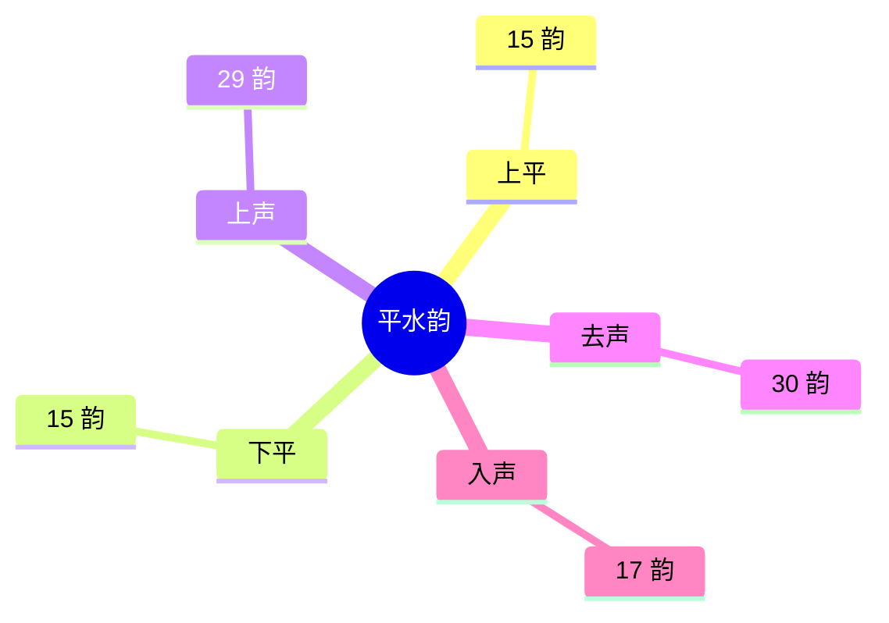

先有“日”，然后才有月、年。有了日，才产生纪日的方法。

最早用十干纪日。汉代出现数字纪日，并与干支配合使用。清代后期出现韵目纪日。

## 十干纪日

干支纪时是中国特有的纪时方法。干支纪日先用十干，后来才发展成干支配合。

- **干（天干）**：共十个，用来标次序。甲、乙、丙、丁、戊、己、庚、辛、壬、癸。
- **支（地支）**：共十二个。子、丑、寅、卯、辰、巳、午、未、申、酉、戌、亥。

## 干支纪日

十日为一个周期，称为一旬，每旬自甲至癸。早期每月按三十日计。后来大月三十日、小月二十九日，单用十干容易错乱，于是改用天干地支相配。

天干、地支逐次相配，组成六十个单位。天干起于甲、地支起于子，顺序是：甲子、乙丑、丙寅、丁卯、戊辰、己巳、庚午、辛未、壬申、癸酉。天干至此走完一轮，地支还剩戌、亥，接下甲戌、乙亥，一直排到癸亥，再从甲子开始下一轮。纪日时，这一轮是六十日。

## 数字纪日

干支纪日需要推算，不能一眼看出是本月的第几天。数字纪日始于何时，还不能确定。

特定日期仍用干支推算。

- **三伏**：夏至后第一个庚日入初伏，一伏十日。立秋后第一个庚日入末伏。若夏至后第五个庚日仍在立秋之前，中伏就不是十日，而是二十日。
- **腊日**：年终祭祀百神叫腊祭，在冬至后第三个戌日举行，这一天叫腊日，所在的月份叫腊月。冬至多在十一月下半月，腊日便落在十二月，所以称十二月为腊月。后来腊日固定在十二月初八，今天仍有喝“腊八粥”的习俗。

## 韵目纪日

金哀宗正大年间，王文郁编《平水新刊韵略》，分一百零六韵，称平水韵。平声分上平、下平，再加上声、去声、入声，共五部分。韵书从每韵取一字作为代表，用来标目，这个字叫韵目。韵目纪日，就是用平水韵的韵目字指代一个月里的各日。

韵目在该部分中的序号对应日期。韵数较少的部分盖不到月末，所以各日能用的韵目多少不同：

- **1–15 日**
  - 可用：上平、下平、上声、去声、入声
  - 韵目数：$5 \times 15 = 75$
- **16–17 日**
  - 可用：上声、去声、入声
  - 韵目数：$3 \times 2 = 6$
- **18–29 日**
  - 可用：上声、去声
  - 韵目数：$2 \times 12 = 24$
- **30 日**
  - 可用：去声
  - 韵目数：$1$

合计 $75 + 6 + 24 + 1 = 106$，与平水韵的韵数一致。三十一日没有对应韵目。

韵目纪日出现于清代后期，最初用于中文电报纪日。

同书：[纪时刻与时辰](/articles/books/zhong-guo-gudai-ji-shi-kao/2.html)、[纪月](/articles/books/zhong-guo-gudai-ji-shi-kao/3.html)、[纪年](/articles/books/zhong-guo-gudai-ji-shi-kao/4.html)。
