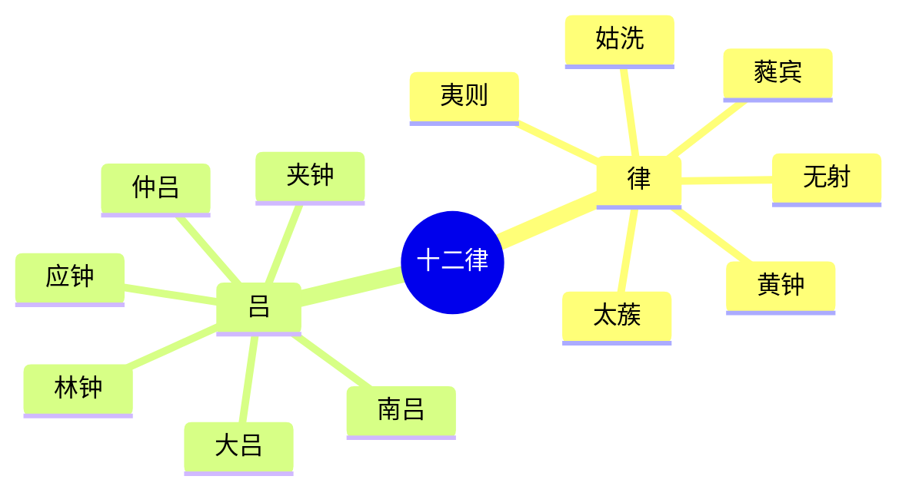

月以月相变化的周期为时段，所以称为“月”。

## 数字纪月

各种纪月方法里，数字纪月起源最早。收在《大戴礼记》中的《夏小正》，是中国最古老的历法，相传为夏代历法的遗存。

数字纪月使用的时间最长，从上古一直沿用到今天。

## 干支纪月

干支纪月主要有斗建、甲子月，以及月阳、月阴。

**斗建**按北斗斗柄黄昏时所指的方位来定月份。夏历正月建寅：

- **春**
  - 正月：寅
  - 二月：卯
  - 三月：辰
- **夏**
  - 四月：巳
  - 五月：午
  - 六月：未
- **秋**
  - 七月：申
  - 八月：酉
  - 九月：戌
- **冬**
  - 十月：亥
  - 十一月：子
  - 十二月：丑

**甲子月**：斗建先把十二个月用十二支固定下来，再依次配上十干。

**月阳**以十干为序，按月亮所在的天干另取名称。《尔雅·释天》：

- **甲**：毕
- **乙**：橘
- **丙**：修
- **丁**：圉
- **戊**：厉
- **己**：则
- **庚**：窒
- **辛**：塞
- **壬**：终
- **癸**：极

月阴是与月阳相对的另一套月名。

## 其他纪月

### 音律纪月

律管共十二个，管径相等，长短不一，用来校定十二个音阶。从低音管算起，奇数六管为律，偶数六管为吕。奇数为阳，偶数为阴。阳六为律，阴六为吕，合称十二律。由低到高依次是黄钟、大吕、太蔟、夹钟、姑洗、仲吕、蕤宾、林钟、夷则、南吕、无射、应钟。

### 月令、习俗与避讳

- **月令**：春分孟春、仲春、季春，夏、秋、冬同例。
- **习俗**：正月叫元月，二月叫杏月，三月叫桃月。
- **宗教**：不同宗教的月份名称不一致。
- **避讳**：因避皇帝名讳而更改月名。

## 月相

朔、望、朏都可以作为确定朔望月周期的标准。

- **朔**：每月的开始，从地球上看不到月亮。
- **望**：每月月圆。
- **朏**：初见新月。

朔日为月首，这一做法一以贯之，至今未改。

## 闰月

十三月指闰月。

月相周期与太阳年长度不同，但二者有近似的整数倍关系，所以可以按周期安排闰月。

- $19$ 个太阳年约为 $6939.60$ 日。
- $235$ 个朔望月约为 $6939.69$ 日。

两者非常接近。$235$ 个朔望月可以写成：

$$
19 \times 12 + 7 = 235
$$

也就是说，$19$ 年如果安排 $12$ 个普通月，再加 $7$ 个闰月，月份总长度就和太阳年相当接近。这就是十九年七闰。在中国古代历法里，它与章法有关，用来协调月相和太阳年。安排闰月的周期叫闰周。

同书：[纪日](/articles/books/zhong-guo-gudai-ji-shi-kao/1.html)、[纪时刻与时辰](/articles/books/zhong-guo-gudai-ji-shi-kao/2.html)、[纪年](/articles/books/zhong-guo-gudai-ji-shi-kao/4.html)。
